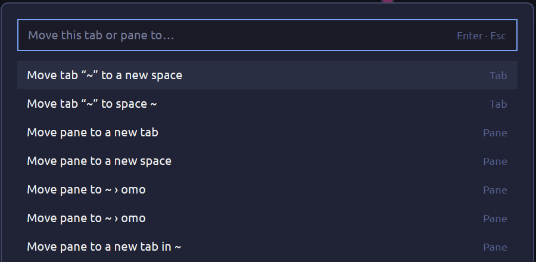

# Move to

A [Herdr](https://herdr.dev/) mod that moves a tab or a pane to another space, to a new space, or to another tab, with the program keeping running.



Herdr has no command for moving tabs or panes between spaces. This mod does it by re-labeling the terminal in herdr-core: it parks the terminal, sets its `herdr.space` and `herdr.tab` labels, and keeps it again. Herdr adopts a terminal with those labels, and an unknown id becomes a new space or tab.

## Install

Ask your agent in Herdr:

```
Read ~/.config/herdr-app/AGENTS.md, then add the mod from github.com/islee23520/herdr-move-to.
```

Or copy `mods/move-to` into `~/.config/herdr-app/mods/` and merge `keys.json`.

## Use

`alt-m` opens the dialog for the focused pane and its tab. Type to filter, Up/Down to choose, Enter to move, Esc to close.

| Entry | Does |
|---|---|
| Move tab to a new space | Every terminal of the tab goes to a new space, one tab |
| Move tab to space X | The tab goes to space X as a new tab |
| Move pane to a new tab | The pane leaves its tab and becomes a tab of its own |
| Move pane to a new space | The pane becomes a new space |
| Move pane to X > Y | The pane joins tab Y of space X |

It works on remote machines too: a space on a machine only lists targets on the same machine.

## In a right-click menu

The dialog reads `props()`. Open it from your own menu mod with the clicked pane or tab:

```js
openOverlay({ mod: "move-to", kind: "dialog", width: 560, height: 420,
  props: { tab: "pane", target: { pane: target.pane } } });   // a pane
openOverlay({ mod: "move-to", kind: "dialog", width: 560, height: 420,
  props: { tab: "tab", target: { id: tabId } } });            // a tab
```

Shipped menus (`menu`) are read-only: clone it first with `herdr-app do mod.clone '{"name":"menu","as":"my-menu"}'`, add the item, and set `"terminal_menu": "my-menu"` on a cloned layout.

## Limits

- Mod panes (not terminals) cannot be moved; they stay where they are.
- Moving a tab moves its terminals into one new tab, so the split arrangement is not kept.
- Nothing is moved across machines.
- The mod runs `hc label` and `hc keep`, and `sleep` through `exec`. It reads no files and uses no network.
