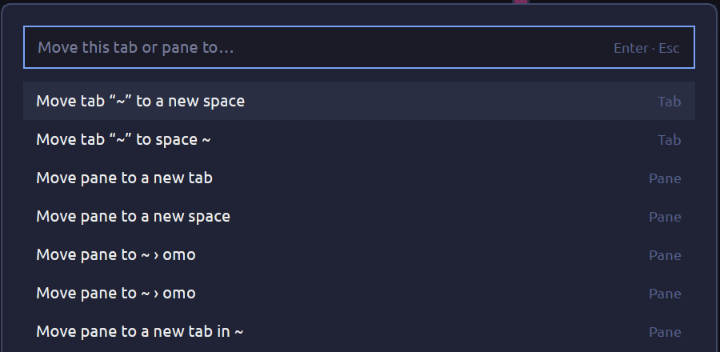

# Move to

A dialog that moves the focused pane, or its whole tab, to another space, a new space, or another tab. The programs keep running. It opens with `alt-m`, or from a context menu that passes it a target.

## What you see

A centered dialog, 560 px wide and 0.6 of the window tall, on the theme's `popover` color. At the top a 34 px input with an `accent` border and the placeholder "Move this tab or pane to…", with "Enter · Esc" on its right in `dim`. Under it a scrolling list of 30 px rows, 12.8 px text. Each row has the action on the left and its group (`Tab` or `Pane`) on the right in `dim` 11.5 px. The selected row uses `selected`, a hovered row `hover`. With nothing to show it says "Nothing to move here."

## How it behaves

- Rows, in order: "Move tab “<name>” to a new space", then "Move tab “<name>” to space <S>" for every other space on the same machine; for a pane (needs a terminal): "Move pane to a new tab", "Move pane to a new space", "Move pane to <S> › <T>" for every other tab of every space on the machine, and "Move pane to a new tab in <S>" for every other space.
- Typing filters rows by the letters in order, ignoring spaces and case. Up/Down move the selection, Enter or a click runs it, Esc closes.
- Which pane or tab: `props().target.pane` (a pane), or `props().tab === "tab"` with `props().target.id` (a tab). Without props, the focused pane.
- A move parks each terminal (`terminal.park`), waits up to 6 s for its pane to disappear, runs `hc label <terminal> herdr.space=<id> herdr.tab=<id>`, then `hc keep <terminal>`. A new space or tab uses a fresh id `sp<32 hex>` or `tb<32 hex>`; Herdr turns an unknown id into a new space or tab. On a remote machine the ids are written without the `<machine>/` prefix.
- Success shows a toast ("Tab moved to a new space", "Pane moved to <S>"); a failed label shows "Move failed" with the error. The dialog closes after the move finishes.
- Rows only list spaces on the same machine as the source. A mod pane has no terminal, so only the tab rows show for it.

## Built from

`mods/move-to/main.js` and `mod.json` (`{"place":"none","overlay":{"kind":"dialog","width":560,"height":0.6}}`). Herdr functions: `spaces()`, `panes()`, `props()`, `theme()`, `run("terminal.park")`, `hc([...])`, `exec("sleep")`, `notify`, `closeOverlay`, `openOverlay` from callers. gpui-base `InputState` and `Input`. `keys.json`: `alt-m` → `mod.open:move-to` in `global`.

## Watch out

- Relabeling a live terminal does nothing by itself: the pane stays until the terminal is parked first. Park, then label, then keep, in that order.
- `terminal.park` only takes effect after the machine replies, so wait for the pane to be gone before labeling.
- `hc label` takes `machine/` addresses for remote terminals, but the label values must not carry the prefix.
- Moving a tab puts its terminals into a single new tab; splits are not rebuilt.
- Mod panes cannot move. Nothing moves between machines.
- A shipped right-click menu cannot be edited; clone it and add an item that calls `openOverlay({ mod: "move-to", kind: "dialog", props })`.

## Done when

- `herdr-app check mods/move-to` passes.
- With a two-pane tab, "Move pane to a new tab" leaves two tabs of one pane each and the shell in each is the same process as before.
- "Move tab … to a new space" creates a space holding the tab, and the old space no longer has it.
- On a remote machine's space, the same entries work and list only that machine's spaces.
